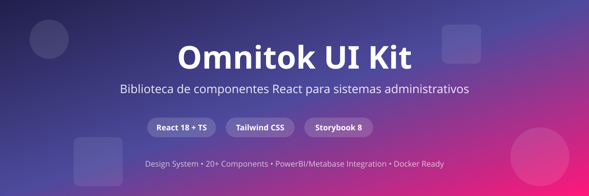

# Omnitok UI Kit



<div align="center">

**Biblioteca completa de componentes React para sistemas administrativos y productos internos**

[](https://opensource.org/licenses/MIT)
[](https://storybook.js.org/docs)
[](https://www.docker.com/)
[](https://react.dev/)
[](https://www.typescriptlang.org/)

</div>

## ✨ Características

- 🎨 **Design System completo** basado en identidad Omnitok
- ⚛️ **React 18 + TypeScript** - Type safety completo
- 🎯 **Tailwind CSS** - Tokens de diseño personalizados
- ♿ **Accesible** - Cumple WCAG 2.1
- 📦 **Tree-shakeable** - Solo importa lo que usas
- 📚 **Storybook 10** - Documentación interactiva
- 🔧 **Monorepo** - Organizado con pnpm workspaces

## 📚 Storybook
Documentacion completa para uso con ejemplos

<a href="https://ui-kit.omnitok.cloud/" target="_blank">https://ui-kit.omnitok.cloud/</a>

## 📦 Instalación

### Pre-requisitos

Requisito para usar iconos
```bash
npm lucide-react
```

Si tu proyecto usa Tailwind CSS, consulta la sección [4. Configurar Tailwind Preset](#4-configurar-tailwind-preset-opcional) para usar los tokens de diseño del UI Kit.

### Paquete principal

```bash
# SSH
npm install git+ssh://git@github.com:pervasivemind/omnitok-ui-kit.git#pkg

# HTTPS
npm install git+https://github.com/pervasivemind/omnitok-ui-kit.git#pkg

# package.json
"@omnitok/ui": "git+ssh://git@github.com:pervasivemind/omnitok-ui-kit.git#pkg"
```

**Para usar componentes drag and drop:**

```bash
npm install @dnd-kit/core @dnd-kit/sortable @dnd-kit/utilities
```

## 🚀 Uso Rápido

```tsx
import { Layout, Button, Card } from '@omnitok/ui';
import '@omnitok/ui/styles.css';
import { Home, Users, Settings } from 'lucide-react';

function App() {
  const sidebarItems = [
    { id: 'dashboard', label: 'Dashboard', icon: <Home size={20} /> },
    { id: 'users', label: 'Usuarios', icon: <Users size={20} />, badge: 5 },
    { id: 'settings', label: 'Configuración', icon: <Settings size={20} /> },
  ];

  return (
    <Layout
      sidebarItems={sidebarItems}
      logo={}
      logoCollapsed={}
      systemName="Mi Sistema"
      activeSidebarId="dashboard"
      headerTitle="Dashboard"
      user={{ name: 'Usuario', role: 'Admin' }}
    >
      <Card>
        <h2>Bienvenido</h2>
        <Button variant="primary">Comenzar</Button>
      </Card>
    </Layout>
  );
}
```

## 📚 Componentes

### Básicos
- **Button** - primary, secondary, outline y ghost; danger, accept e info solo en diálogos de confirmación
- **Input** - Campos de texto con validación y estados
- **Select** - Dropdowns personalizados
- **Textarea** - Áreas de texto
- **Checkbox** - Casillas de verificación
- **Radio** - Botones de radio

### Display
- **Card** - Contenedores con headers coloridos
- **Badge** - Etiquetas de estado
- **Avatar** - Avatares de usuario
- **Alert** - Mensajes de alerta

### Layout
- **Sidebar** - Navegación lateral con logo centrado y collapse
- **BrandHeader** - Cabecera navy del shell v3
- **Layout** - Layout completo (sidebar + header + content + panel opcional)
- **Breadcrumb** - Migas de pan para navegación

### Data
- **Table** - Tablas con headers coloridos y sorting
- **Tabs** - Pestañas con 3 variantes (default, pills, underline)
- **Pagination** - Paginación de datos

### Feedback
- **Modal** - Modales con headers coloridos
- **Toast** - Notificaciones temporales

### Pages
- **LoginPage** - Login en pantalla dividida

### Drag and Drop
- **FileDropzone** - Zona de arrastrar y soltar archivos con validación

## 🎨 Design System

### Colores de Marca
- **Sidebar**: `#211f4b` (obligatorio para sidebar)
- **Primary**: `#4D4A9D` (púrpura)
- **Accent**: `#FF177B` (magenta)

### Gradientes
- **Sidebar activo**: `linear-gradient(90deg, #FF177B 0%, #4D4A9D 100%)`
- **Headers**: `linear-gradient(90deg, #4D4A9D 0%, #3B3880 100%)`

### Tipografía
- **UI**: Nunito Sans
- **Contenido**: Open Sans

### Logos
- **Sidebar expandido**: `logo_largo_blanco.png` (horizontal blanco)
- **Sidebar colapsado**: `logo_cuadrado_color.png` (cuadrado color)
- **Login**: `logo_largo_color.png` (horizontal color)

## 🔧 Desarrollo

### Setup del repositorio

Recomendamos usar pnpm como package manager.

https://pnpm.io/installation


```bash
# Clonar repositorio
git clone https://github.com/pervasivemind/omnitok-ui-kit.git

# Instalar dependencias
pnpm install

# Levantar instancia local
pnpm dev
```

### Comandos útiles

```bash
# Desarrollar componentes
pnpm --filter @omnitok/ui dev

# Build solo core package
pnpm --filter @omnitok/ui build

# Ejecutar Storybook
pnpm --filter storybook dev

# Build Storybook
pnpm --filter storybook build
```

## 🐳 Docker

### Build y Run

```bash
# Build imagen
docker build -t omnitok-ui-storybook .

# Run container
docker run -p 8080:80 omnitok-ui-storybook

# O usar docker-compose
docker-compose up -d
```

Accede a Storybook en: http://localhost:8080

### Deploy en Producción

```bash
# Build para producción
docker build -t omnitok-ui-storybook:latest .

# Push a registry
docker tag omnitok-ui-storybook:latest registry.ejemplo.com/omnitok-ui-storybook:latest
docker push registry.ejemplo.com/omnitok-ui-storybook:latest
```

## 📖 Documentación Completa

Visita nuestro **Storybook** para documentación interactiva completa:

- 🎨 **Design System**: Colors, Typography, Layout, Icons, Patterns
- 📦 **Components**: Documentación de cada componente con ejemplos en vivo
- 📄 **Pages**: LoginPage y ejemplos completos
- 📊 **PowerBI & Metabase**: Guías de integración
- 💡 **AI Analytics**: Ejemplo con panel de insights

**Live Demo**: https://pervasivemind.github.io/omnitok-ui-kit

## 🔗 Integración en Proyectos

### 1. Instalar paquete

```bash
npm install @omnitok/ui lucide-react
```

### 2. Importar estilos

```tsx
// En tu archivo principal (App.tsx o main.tsx)
import '@omnitok/ui/styles.css';
```

### 3. Usar componentes

```tsx
import { Layout, Button, Card, Table } from '@omnitok/ui';
import { Home, Users, Settings } from 'lucide-react';

// Ver ejemplos completos en Storybook
```

### 4. Configurar Tailwind Preset (opcional)

Si tu proyecto usa Tailwind CSS, puedes importar el **preset** de Omnitok para tener acceso a los mismos tokens de diseño (colores, tipografía, spacing, sombras, animaciones, etc.) que usa el UI Kit.

#### Instalar Tailwind CSS

Si tu proyecto aún no tiene Tailwind CSS, instálalo junto a sus dependencias:

```bash
npm install -D tailwindcss @tailwindcss/postcss postcss autoprefixer
```

Crea un archivo `postcss.config.js` (o `.mjs`) en la raíz de tu proyecto:

```js
export default {
  plugins: {
    '@tailwindcss/postcss': {},
    autoprefixer: {},
  },
};
```

#### Configurar el preset

Importa el preset en tu `tailwind.config.ts` (o `.js`):

```ts
import type { Config } from 'tailwindcss';
import omnitokPreset from '@omnitok/ui/tailwind-preset';

const config: Config = {
  presets: [omnitokPreset],
  content: ['./src/**/*.{js,ts,jsx,tsx}'],
};

export default config;
```

Esto habilita clases como `bg-primary`, `text-accent`, `font-sans` (Nunito Sans), `shadow-card`, `animate-fade-in`, etc. en tu proyecto, manteniendo consistencia visual con los componentes del UI Kit.

> **Nota:** El preset proporciona solo los tokens de diseño. La importación de `@omnitok/ui/styles.css` sigue siendo necesaria para los estilos de los componentes.

### 5. Agregar logos

Coloca tus logos en la carpeta `public/` de tu proyecto:
- `logo_largo_blanco.png` - Para sidebar expandido
- `logo_cuadrado_color.png` - Para sidebar colapsado
- `logo_largo_color.png` - Para login

## 🤖 MCP Server (AI IDE Integration)

Omnitok UI Kit expone un servidor **MCP (Model Context Protocol)** que permite a editores con IA —como **Cursor**, **Windsurf**, **VS Code con Copilot** u otros clientes MCP— consultar la documentación y especificaciones de los componentes directamente desde el IDE.

**Endpoint**: `https://ui-kit.omnitok.cloud/mcp`

### Configurar en Cursor

Agrega la siguiente entrada en tu archivo `.cursor/mcp.json` (a nivel de proyecto o global):

```json
{
  "mcpServers": {
    "omnitok-ui-kit": {
      "url": "https://ui-kit.omnitok.cloud/mcp"
    }
  }
}
```

### Configurar en VS Code (Copilot)

Agrega la entrada en tu archivo `.vscode/mcp.json`:

```json
{
  "servers": {
    "omnitok-ui-kit": {
      "type": "sse",
      "url": "https://ui-kit.omnitok.cloud/mcp"
    }
  }
}
```

### Configurar en Windsurf

Agrega la entrada en tu archivo `~/.codeium/windsurf/mcp_config.json`:

```json
{
  "mcpServers": {
    "omnitok-ui-kit": {
      "serverUrl": "https://ui-kit.omnitok.cloud/mcp"
    }
  }
}
```

### ¿Qué puedes hacer con el MCP?

Una vez conectado, tu asistente de IA puede:

- **Listar todos los componentes** disponibles en el UI Kit
- **Consultar la documentación** de un componente específico (props, variantes, ejemplos)
- **Generar código** usando los componentes correctos con sus props reales
- **Entender el Design System** (colores, tipografía, patrones)

> **Tip**: Después de configurar el MCP, prueba pedirle a tu asistente de IA: *"Usa los componentes de Omnitok UI Kit para crear un formulario de registro"*.

## 🏗️ Estructura del Proyecto

```
omnitok-ui-kit/
├── packages/
│   └── core/                # Biblioteca de componentes (@omnitok/ui)
│       ├── src/
│       │   ├── components/  # Componentes React
│       │   ├── styles/      # Estilos CSS
│       │   └── utils/       # Utilidades
│       ├── package.json
│       ├── tailwind.config.ts
│       ├── tailwind.preset.js
│       └── vite.config.ts
├── apps/
│   └── storybook/           # Documentación interactiva
│       ├── .storybook/      # Configuración de Storybook
│       ├── src/stories/
│       │   ├── docs/        # Documentación del Design System
│       │   └── examples/    # Ejemplos de páginas completas
│       ├── package.json
│       └── tailwind.config.ts
├── workers/
│   └── mcp/                 # MCP Server (Cloudflare Worker)
│       ├── src/index.ts     # Handler del MCP con @storybook/mcp
│       ├── wrangler.toml    # Configuración Cloudflare
│       └── package.json
├── docs/                    # Documentación adicional de componentes
├── .github/workflows/       # CI/CD pipelines
├── Dockerfile               # Para deployar Storybook
├── docker-compose.yml
├── nginx.conf               # Configuración Nginx para Storybook
├── turbo.json               # Configuración Turborepo
└── pnpm-workspace.yaml
```

## 🎯 Convenciones

1. **Sidebar siempre a la izquierda** - Patrón obligatorio
2. **Logo centrado** en header del sidebar
3. **Colores vibrantes** en headers (tables, cards, modals)
4. **Botón de colapsar** siempre visible
5. **Íconos de Lucide** exclusivamente
6. **Responsive** - Mobile-first approach

## 📝 Ejemplos Completos

Ver en Storybook > Examples:
- **Dashboard** - Dashboard con KPIs y gráficos
- **Forms** - Formularios de productos y usuarios
- **Tables** - Listados con acciones
- **AI Analytics** - Dashboard con panel de insights IA

## 🤝 Contribuir

Este es un proyecto interno de Omnitok. Para contribuir:

1. Fork el repositorio
2. Crea una rama con tu feature (`git checkout -b feature/amazing-feature`)
3. Commit tus cambios (`git commit -m 'Add amazing feature'`)
4. Push a la rama (`git push origin feature/amazing-feature`)
5. Abre un Pull Request

## 📄 Licencia

MIT © Omnitok

## 🔗 Links

- **GitHub**: https://github.com/pervasivemind/omnitok-ui-kit
- **Storybook**: https://pervasivemind.github.io/omnitok-ui-kit
- **MCP Server**: https://ui-kit.omnitok.cloud/mcp
- **NPM**: https://www.npmjs.com/package/@omnitok/ui (cuando se publique)

## 💬 Soporte

Para dudas o issues, abre un issue en GitHub o contacta al equipo de desarrollo.
